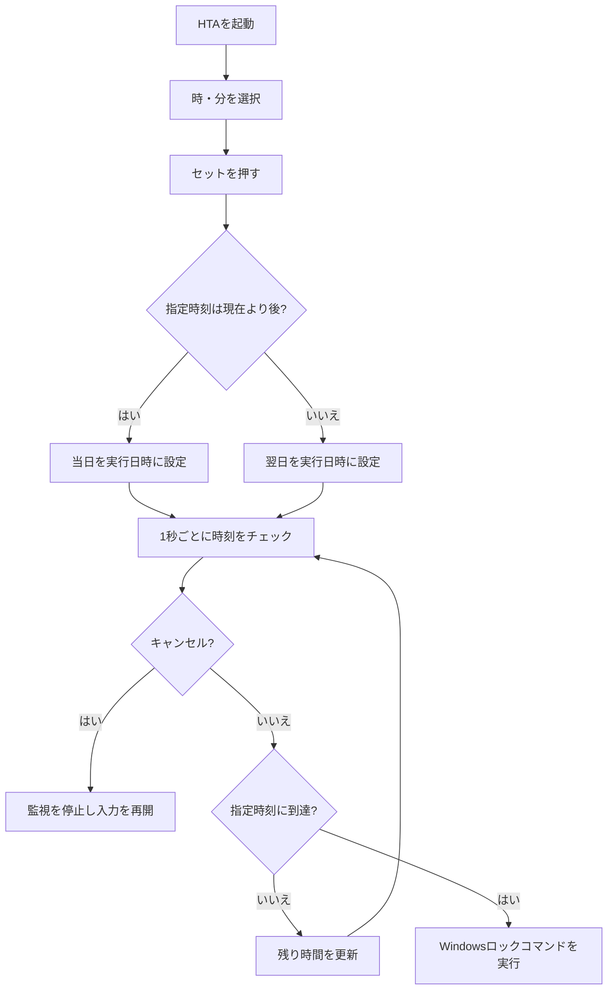

# PC Auto Locker — Windows自動ロックタイマー

> **一言でいうと：** 指定した時刻にWindowsの画面をロックして、作業に没頭していても区切りを作るデスクトップタイマー。

**バージョン：** v1.5（提示された最新ソース）  
**状態：** 動作確認済み（開発者による申告。OSバージョン・個別テスト記録は未確認）  
**実行ファイル：** [`src/AutoLockTimer.hta`](src/AutoLockTimer.hta)

## 1. プロジェクト概要（Overview）

| 項目 | 内容 |
| --- | --- |
| プロジェクト名 | PC Auto Locker（PC自動ロックタイマー） |
| 対象OS | Windows（HTA / Windows Script Hostが利用可能な環境） |
| 使用技術 | HTML、CSS、JavaScript、HTA（HTML Application）、ActiveX / `WScript.Shell` |
| 使用するWindows機能 | `rundll32.exe user32.dll,LockWorkStation` |
| 追加ライブラリ | なし |
| デザイン | カード型UI、時刻ピッカー、5色のカラーテーマ |
| 開発環境の詳細 | Windowsのバージョン・エディタ・開発用パスは未確認 |
| 進捗 | v1.0〜v1.5の開発記録あり。v1.5の動作確認済み（申告） |

**重要：** このツールが行うのは**Windowsセッションのロック**であり、PCのシャットダウン、アプリケーション終了、作業内容の自動保存ではありません。作業中のアプリケーションは原則として開いたままです。

## 2. 課題（Problem）

作業に没頭すると時刻を忘れ、次の予定やタスクへの切り替えが遅れる場合があります。一般的なアラームや通知は閉じた後に作業を続けられるため、作業を中断するきっかけとして不十分な場合があります。

そのため、通知を出すだけでなく、設定した時刻に**操作中のデスクトップをロック画面へ切り替える**仕組みが必要でした。

## 3. 目的（Objective）

- 利用者が「時」「分」でロック予定時刻を設定できること。
- 指定時刻になったらWindowsの画面ロックを実行すること。
- ロックまでの残り時間を視覚的に確認できること。
- 実行前にタイマーをキャンセルできること。
- 追加ライブラリを必要としない単一のHTAファイルで運用できること。

**成功基準：** HTAを起動し、未来の時刻を設定したとき、予定時刻に画面ロックが発生すること。現行版は開発者から**動作確認済み**との報告があります。ただし、OS・試験時刻・ログなどの詳細は記録されていません。

## 4. 方法（Method）

### 4.1 システム構成と技術選定

| 技術・機能 | 担当する役割 | 採用理由・位置づけ |
| --- | --- | --- |
| HTA（`.hta`） | デスクトップウィンドウとして実行 | HTMLベースのUIからWindowsのローカル機能を呼び出せる |
| HTML / CSS | 時刻選択、ボタン、テーマ、状態表示 | 画面構築を単一ファイルにまとめられる |
| JavaScript | 日時計算、タイマー監視、残り時間表示 | UI操作と時刻判定を制御する |
| `setInterval(..., 1000)` | 約1秒間隔の状態確認 | 残り時間と実行時刻を更新する |
| `ActiveXObject("WScript.Shell")` | Windowsコマンドを起動 | HTA上でWindows Script Hostの機能を使用する |
| `LockWorkStation` | Windowsセッションをロック | 目的である作業中断をOS標準機能で実現する |

JavaScriptとCSSは**`AutoLockTimer.hta`内に直接記載**されており、外部のJS/CSSファイルへの依存はありません。

### 4.2 処理フロー



### 4.3 実装されている機能

1. **時刻指定：** 時は00〜23、分は00〜59。初期値は**18:30**。選択メニューと各「＋」「－」ボタンで調整する。
2. **日付繰り越し：** 指定した時刻が現在時刻以前なら、実行日時を翌日にする。
3. **残り時間表示：** 「時間・分・秒」を画面に更新表示する。
4. **実行中の入力制限：** セット後は時刻入力とセットボタンを無効にし、キャンセルを有効にする。
5. **実行前キャンセル：** 監視用インターバルを停止し、時刻選択を再開する。
6. **色変更：** ブルー、オレンジ、グリーン、ブラック、ナチュラルの5テーマを丸いアイコンで変更する。
7. **画面ロック：** 指定時刻にWindows標準コマンドを実行する。

### 4.4 主要関数と処理内容

| 関数・処理 | 実装位置 | 役割 |
| --- | --- | --- |
| `window.onload` | `<script>` | 時・分の選択肢を生成し、初期値を設定 |
| `changeTheme(theme)` | `<script>` | `<body>`のテーマクラスと選択状態を変更 |
| `adjustTime(dh, dm)` | `<script>` | 「＋」「－」ボタンで時刻を増減。日付境界も計算 |
| `toggleInputs(disabled)` | `<script>` | セット中のボタン・時刻入力の有効/無効を切替 |
| `setTimer()` | `<script>` | 実行日時を決定し、監視とカウントダウンを開始 |
| `cancelTimer()` | `<script>` | 監視を停止し、キャンセル状態を表示 |
| `updateCountdownDisplay()` | `<script>` | 予定日時までの残り時間を表示 |
| `checkTime()` | `<script>` | 到達判定とWindows画面ロックコマンドの実行 |

**実際に使用しているロック処理**（ソースの抜粋）：

```javascript
var shell = new ActiveXObject("WScript.Shell");
shell.Run("rundll32.exe user32.dll,LockWorkStation", 0, false);
```

`0`はコマンド実行時のウィンドウ表示指定、`false`はコマンドの終了を待機しない指定です。コマンド起動後の**ロック完了自体を検証する処理はありません**。

ソース全文は [`src/AutoLockTimer.hta`](src/AutoLockTimer.hta) を参照してください。ドキュメントと実行用コードは分離しています。

### 4.5 起動・操作手順

1. このリポジトリをダウンロードまたはクローンし、Windowsの任意のフォルダーに保存する。
2. `src/AutoLockTimer.hta` をダブルクリックして起動する。必要に応じて、Windowsのコマンドプロンプトから `mshta.exe "src\AutoLockTimer.hta"` で起動する（リポジトリ直下で実行）。
3. 「時」「分」を設定して**セット**を押す。時刻が既に過ぎていれば翌日を対象にする。
4. ロック予定時刻と残り時間が表示される。ウィンドウを**最小化**して作業を続ける。
5. 中止する場合は**キャンセル**を押す。指定時刻に到達するとWindowsのロック画面に移る。

**運用上の注意：** 実行中はHTAウィンドウを閉じないでください。閉じるとJavaScriptのタイマーが停止します。また、スリープ・休止状態・サインアウト中にロック処理が予定時刻どおりに行われることは保証できません。

**セキュリティ：** HTAはローカルのWindows機能を呼び出せる形式です。実行する際はコードを確認し、信頼できるファイルだけを使用してください。端末の組織ポリシーによりHTA/ActiveXが制限される場合があります。

## 5. ファイル構成・保存場所（File Structure）

以下は**GitHub公開用として新規にまとめた構成**です。開発時に存在した元のローカル保存先は**未確認**です。

```text
pc-auto-lock-timer/                  # 提案するリポジトリ名（ローカル絶対パスは未確認）
├── README.md                        # プロジェクト全体の技術レポート
├── src/
│   └── AutoLockTimer.hta            # 実行用コード（HTML/CSS/JavaScript/HTA）
├── docs/
│   ├── troubleshooting.md           # エラー・制約・対処の記録
│   ├── changelog.md                 # v1.0〜v1.5の変更履歴
│   ├── verification.md              # 動作確認状況とテスト観点
│   └── github-upload.md             # GitHubアップロード手順・コミット案
└── .gitignore                       # 一時ファイルなどの除外設定
```

| ファイル | リポジトリ内のパス | 保存対象 | 役割・依存関係 |
| --- | --- | --- | --- |
| レポート | `README.md` | GitHub公開 | `src/`と`docs/`を参照 |
| 実行用HTA | `src/AutoLockTimer.hta` | GitHub公開・ローカル実行 | 全UI・関数を内包。Windows標準機能に依存 |
| トラブルシューティング | `docs/troubleshooting.md` | GitHub公開 | 実際のエラー記録と、想定される問題を区別 |
| 変更履歴 | `docs/changelog.md` | GitHub公開 | 開発記録にあるv1.0〜v1.5を整理 |
| 検証記録 | `docs/verification.md` | GitHub公開 | 動作確認済みの申告と未確認条件を記録 |
| GitHub操作手順 | `docs/github-upload.md` | GitHub公開 | リポジトリ作成・コミット・プッシュ方法 |
| 除外設定 | `.gitignore` | GitHub公開 | OSやエディタが生成する不要ファイルを除外 |
| 元の開発メモ | `timer.md`（添付） | このZIPには未収録 | 参考資料。元ファイルのローカル保存先は未確認 |
| 元のレポート指示 | `GitHub技術レポート作成.md`（添付） | このZIPには未収録 | 本文書の編集基準。元ファイルのローカル保存先は未確認 |

**設定ファイルについて：** 現行コードに独立した設定ファイルはありません。初期時刻などはHTA内に記述されているため、実体のない`config/`は設けていません。

## 6. 発生した問題と解決方法（Troubleshooting）

添付された開発記録には、**具体的な例外メッセージ・不具合発生日・調査ログの記載はありません**。過去にエラーが発生したと断定せず、既知の制約・一般的な確認方法を [`docs/troubleshooting.md`](docs/troubleshooting.md) に分離しました。

現行実装ではロックコマンドの呼び出しを`try/catch`で囲み、例外時に「ロックの実行に失敗しました。」と表示する処理があります。ただし、そのメッセージが実際に出た記録はありません。

## 7. 変更履歴（Change Log）

添付の開発メモに基づく変更履歴です。**各版の開発日付は未確認**のため記載しません。

| バージョン | 変更前 | 変更後 | 変更理由 | 結果 |
| --- | --- | --- | --- | --- |
| v1.0 | タイマー未実装 | 指定時刻にWindowsをロックする基本機能 | 通知だけでは作業を中断しにくいため | 基本機能を実装 |
| v1.1 | HTAの従来型UI | Flexbox・角丸・影を使ったカード型UI | 視認性と操作性の向上 | UIを刷新 |
| v1.2 | 実行までの残り時間が分からない | 時・分・秒のカウントダウン | 時間経過の把握を容易にするため | 1秒単位の表示処理を追加 |
| v1.3 | 時刻入力中心の操作 | 時・分の「＋」「－」操作と選択UI | 入力操作を直感的にするため | 時刻ピッカーを追加 |
| v1.4 | カラー切り替えなし | 5色のテーマ切り替え（プルダウン） | 好みに応じた画面表示を可能にするため | テーマ機能を追加 |
| v1.5 | プルダウン式のテーマ選択・調整前の配色 | 丸いスウォッチ式選択、淡いナチュラル色、余白調整 | テーマ選択を直感的にし、見やすさを改善するため | 現行ソースに反映、動作確認済み（申告） |

詳細は [`docs/changelog.md`](docs/changelog.md) を参照してください。

## 8. 検証結果（Results）

**現行版v1.5について、開発者から「動作確認済み」と報告されています。** ただし、機能単位の試験結果や証跡は提供されていないため、個別の試験を「成功」とは判定していません。

| 試験項目 | 期待する結果 | 実際の結果・証跡 | 判定 |
| --- | --- | --- | --- |
| 現行版の動作 | 実行環境で正常に使える | 開発者による動作確認済みの申告 | **確認済み（申告ベース）** |
| 指定時刻のロック | 指定時刻にWindowsがロックされる | 試験時刻・ログ未提供 | 個別記録は未確認 |
| カウントダウン | 約1秒ごとに残り時間を表示 | 個別試験記録なし | 未確認 |
| キャンセル | ロック監視が停止する | 個別試験記録なし | 未確認 |
| 日付繰り越し | 過去時刻の指定は翌日の対象になる | 境界条件の試験記録なし | 未確認 |
| 5つのテーマ | 選択に応じて表示が変わる | 個別試験記録なし | 未確認 |
| スリープ・復帰 | 復帰後の挙動が仕様どおり | 試験記録なし | 未検証 |

これらの**未確認**は「動作しない」という意味ではありません。記録が不足している項目を示しています。試験手順と記入用の表は [`docs/verification.md`](docs/verification.md) にまとめています。

## 9. 今後の課題（Next Steps）

| 優先度 | 内容 | 理由 | 状態 |
| --- | --- | --- | --- |
| 高 | Windowsのバージョンと試験項目を記録 | 再現性を確保する | 未記録 |
| 高 | 指定時刻ロック・キャンセル・翌日繰り越しを個別に記録 | 主要機能の回帰テストに利用する | 個別結果は未確認 |
| 中 | コマンド呼び出し成功とロック完了の扱いを見直す | 現行コードは実際のロック完了を確認せず「実行しました」と表示するため | 改善案・未実装 |
| 中 | スリープ復帰時やシステム時刻変更時の挙動を評価 | タイマー監視の遅延・不整合に備える | 未検証 |
| 低 | 初期時刻・テーマの設定保存 | 再起動後の操作を省く | 改善案・未実装 |
| 低 | アクセシビリティ・キーボード操作改善 | 操作方法の選択肢を増やす | 改善案・未実装 |

## 参考ドキュメント

- [トラブルシューティング](docs/troubleshooting.md)
- [変更履歴](docs/changelog.md)
- [検証チェックリスト](docs/verification.md)
- [GitHubアップロード・コミット手順](docs/github-upload.md)

**公開に関する注記：** 本リポジトリに収録したHTAは提示された現行コードを独立ファイルにしたものです。実際のWindows環境で本ZIPから再テストしたという意味ではありません。ライセンスは未指定です。
