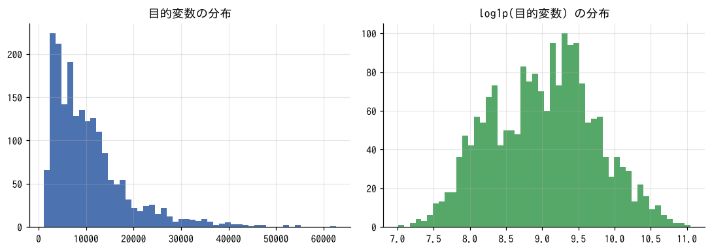
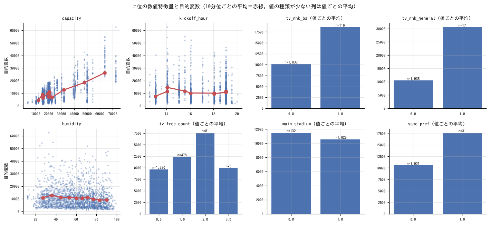
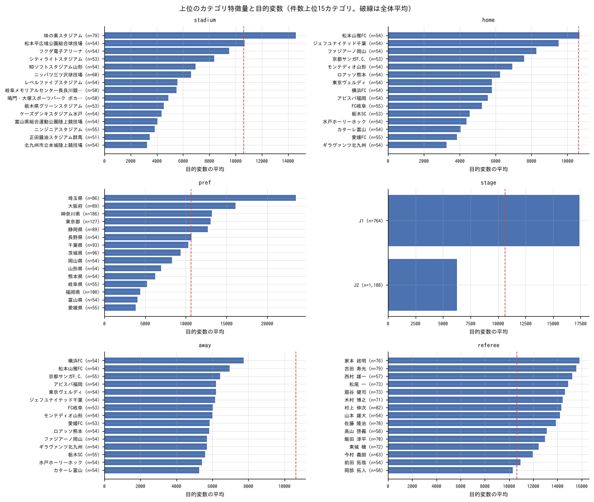
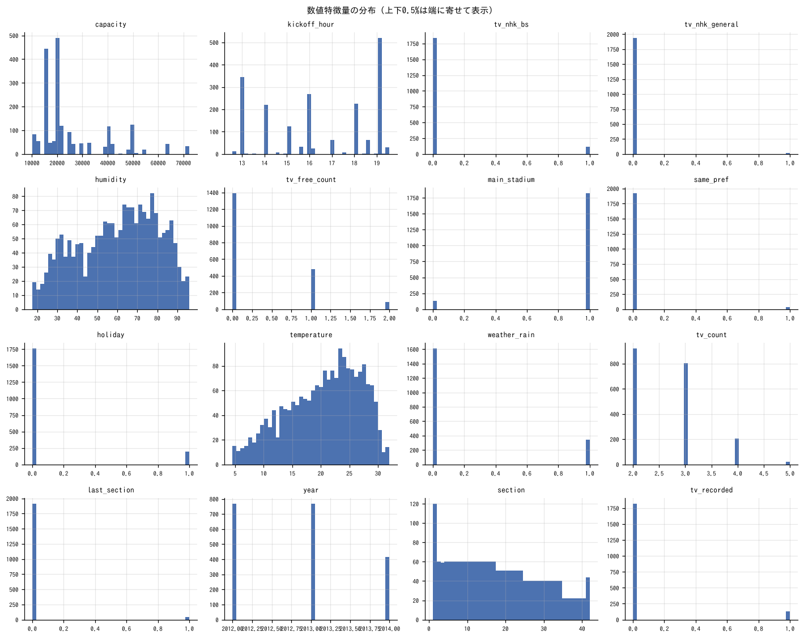
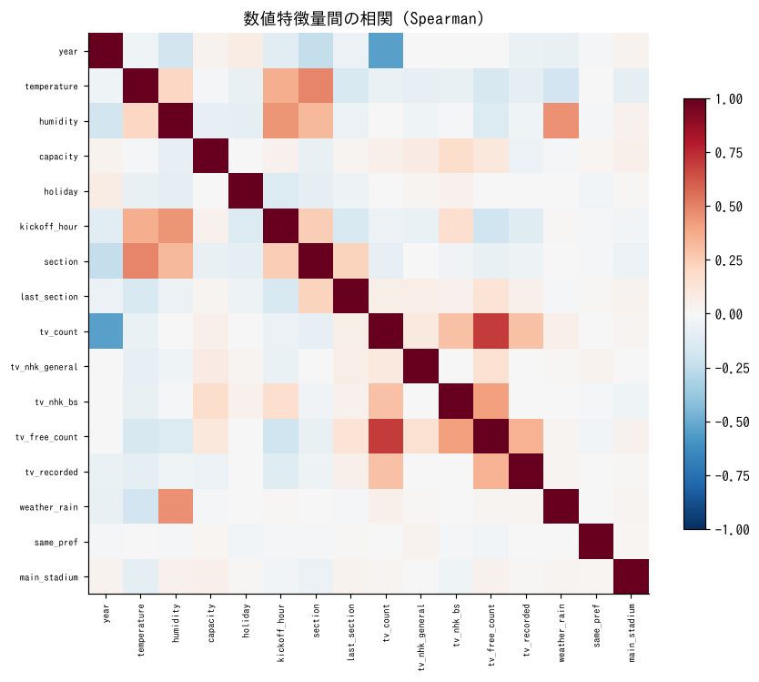
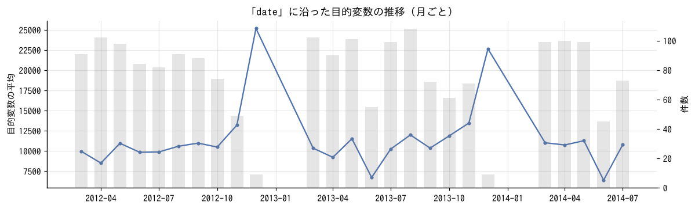
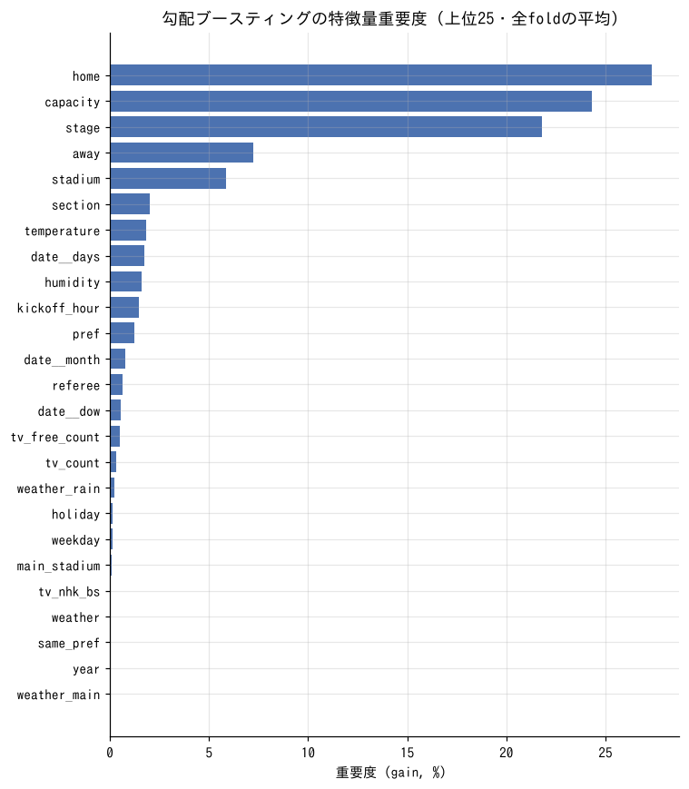
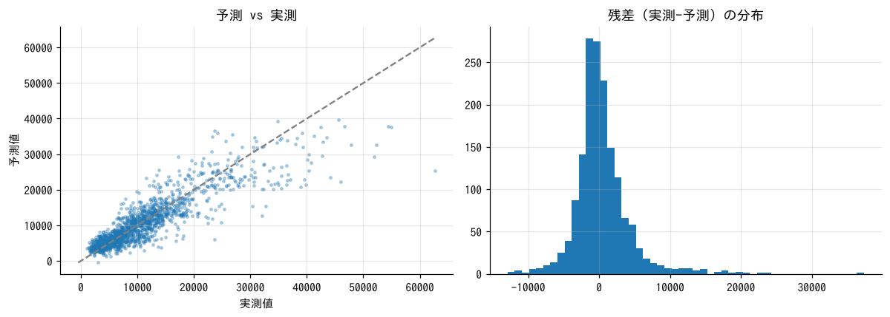

# 初期分析レポート: Jリーグ観客動員数予測

- 実行日: 2026-11-06　／　データ: `train_merged.csv`（1,952行 × 29列）　／　テスト: `test_merged.csv`
- 課題: Jリーグ公式戦2014年シーズン後半戦全試合の観客動員数を予測する（評価: RMSE）
- 目的変数: `y`（回帰）　／　主指標: **rmse**
- 分析対象: 1,952行、特徴量 27列（ID 1列は除外）

## 0. まとめと考察

### 結論（3行）
- 観客数は **「どのチームのホームか」「スタジアムの大きさ」「J1 か J2 か」** でほぼ決まる（重要度の上位3つで約 73%）。曜日・中継・天気の影響は小さい。
- ベースラインの RMSE は **3,869**（LightGBM、時系列の交差検証）。何も学習しない場合は 8,281。
- 初期モデルでは「収容率で学習」と「チーム・スタジアムの過去の実績」を加え、RMSE は **3,465**（-10%）。提出ファイルは `submit_initial.csv`。

### データの準備で行ったこと（`prepare.py`）
- `train` + `train_add`（計 1,953 試合）を学習データとし、`condition`（天気・気温・湿度・審判）と `stadium`（収容人数・都道府県）を試合 id とスタジアム名で結合した。スタジアム名はすべて結合できた。
- **2014/3/23 浦和-清水（観客 0 人）は除外した**。処分による無観客試合で、通常の試合と仕組みが違うため。
- `condition` のスコア（試合後の情報）と先発選手名は使っていない。
- 「08/02(土)」→ 日付・曜日・祝日、「第18節第1日」→ 節番号と最終節フラグ、中継の文字列 → 中継局数・NHK総合・NHK BS・地上波の局数・録画、天気 → 主な天気と雨の有無、に分解した。地元対決（両チームの本拠地が同じ県）も追加した。
- `2014_add.csv`（予測対象外の 2014 年後半 38 試合）は使っていない。

### 見えた傾向
| 要素 | 傾向 |
|---|---|
| J1 / J2 | 平均 **17,400 人 / 6,285 人**。収容率は 57% / 32%。同じチームでも J2 に落ちると大きく減る（例: ガンバ大阪は 2013 年が J2） |
| ホームチーム | J1 は浦和 **37,249 人**（埼玉スタジアム 63,700 席）が突出。新潟 25,155、横浜FM 24,604、FC東京 24,487 と続く。J2 は松本山雅が 10,677 人で最多、北九州・讃岐・群馬は 3,300〜3,500 人 |
| 収容人数 | 大きいほど多いが、比例はしない。収容率は平均 42%、中央値 39%。95% を超えた試合は 0.3% だけで、満員で頭打ちになることはほぼない |
| 曜日 | 土曜 **14,498 人**、日曜 7,459 人。ただし J1 は土曜、J2 は日曜の開催が多いので、曜日の差の多くは J1/J2 の差による |
| 時期 | J1 は 3〜11 月が 15,400〜18,900 人で、**12 月（最終節）は 23,903 人**。J2 も 11 月が 8,847 人と高い。予測対象は 8〜12 月なので、終盤の盛り上がりの再現が鍵 |
| アウェイチーム | J1 で浦和・G大阪・鹿島がアウェイの試合は 20,000〜23,000 人、甲府・大分・徳島だと 13,000〜14,500 人 |
| 中継 | NHK総合で中継された試合は平均 30,547 人（17 試合）、NHK BS は 18,581 人（116 試合）。注目試合が中継されるためで、原因と結果が逆の可能性がある（それでも試合前に分かる情報なので特徴量としては使える） |
| 地元対決 | 両チームの本拠地が同じ県だと平均 17,643 人（31 試合）、それ以外は 10,522 人 |
| 年 | 2012〜2014 年で J1・J2 とも平均はほぼ横ばい |

- 予測を大きく外したのは、浦和のホームと 2013 年最終節の横浜FM-新潟（62,632 人、予測 25,272 人）。優勝争いなど「その試合だけの盛り上がり」はいまのデータでは説明できない。
- train と test の違い: 判別モデルの AUC は 0.92 と高い。ただし、効いているのは節番号・気温・湿度で、test が後半戦（8〜12 月）だから当然の差。チーム・スタジアムに test だけのものはない。

### 特徴量エンジニアリングの提案（優先順）
| # | 案 | 根拠（数字） | 期待効果 | 初期モデルで試した結果 |
|---|---|---|---|---|
| 1 | **収容率（観客数 ÷ 収容人数）を予測して、収容人数を掛けて戻す** | 収容人数が観客数の主な決め手で、スタジアムの大きさが 3,560〜72,327 席と幅広い | スタジアムの大きさの違いをモデルが学ばなくてよくなる | **RMSE 3,869 → 3,674**（これだけで -195） |
| 2 | **ホームチームの過去の平均観客数・平均収容率**（同じディビジョン内、試合日より前のデータだけ） | ホームチームの重要度が 1 位（27%） | チームの集客力を数字で直接渡す。J1/J2 の入れ替えにも対応できる | 収容率で学習＋下記 3〜5 と合わせて **3,674 → 3,465**。`home_past_occ` の重要度 13.8% |
| 3 | アウェイチームの過去の平均観客数 | 浦和・G大阪がアウェイだと +6,000〜9,000 人 | アウェイの集客力 | 重要度 4.7% |
| 4 | スタジアムでの過去の平均収容率 | 同じチームでもメイン以外のスタジアムでは平均が違う | 立地・アクセスの代わり | 重要度 8.6% |
| 5 | 期待観客数 = 収容人数 × ホームの過去の平均収容率 | 1 と 2 の組み合わせ | 素直な目安を渡す | 重要度 2.9% |
| 6 | 順位・勝ち点（優勝争い・昇格争い・残留争い） | 外した試合の多くが終盤の大一番 | 終盤の盛り上がりを表す | **未実施**。`condition` のスコアから試合日より前の順位を計算できる |
| 7 | 前節までの連勝・連敗、ホームでの直近の成績 | 同上 | 調子の良いチームは客が増える | 未実施（スコアから計算できる） |
| 8 | 最終節・開幕戦・ホーム最終戦のフラグ | 12 月の J1 は平均 23,903 人 | 特別な試合 | 最終節は追加済み。ホーム最終戦は未実施 |
| 9 | 代表選手・有名選手の数（先発選手名から） | 未確認 | スター選手の集客力 | 未実施。選手名の名寄せが必要 |
| 10 | 開催日の天気予報の代わりとして雨フラグ・気温 | 雨の日の差は小さい（相関 -0.06） | 小さい | 追加済み。効果はほぼなし |

- 「log(観客数) で学習」も試したが、RMSE は 3,661 で、収容率で学習する方（3,465）が良かった。

### モデルについて
| 構成 | RMSE（時系列の交差検証の平均） |
|---|---|
| 何も学習しない（平均値を予測） | 8,281 |
| 線形モデル（Ridge） | 3,943 |
| LightGBM（そのままの特徴量） | 3,869 |
| LightGBM＋特徴量（観客数で学習） | 3,686 |
| LightGBM＋収容率で学習（特徴量の追加なし） | 3,674 |
| log(観客数) で学習＋特徴量 | 3,661 |
| **LightGBM＋収容率で学習＋特徴量** | **3,465** |

- 検証は「過去で学習して未来で検証する」5 分割で、本番（2014 年 7 月までで学習 → 8 月以降を予測）と同じ向きにしている。最初の分割は学習データが約 330 試合と少なく、スコアが悪く出やすい。
- 過去の実績の特徴量は、交差検証の中では検証期間内の直前の試合も使っている。本番の test では 7 月以降の試合結果は使えないので、本番のスコアは交差検証より少し悪くなる可能性がある。
- 予測の平均は J1 18,980 人、J2 7,457 人。学習データ（17,400 / 6,285）より高めだが、後半戦は観客が多いという傾向と合っている。

### 次の一手
1. **試合日時点の順位・勝ち点を作る**（`condition` のスコアから計算）。終盤の大一番を外している点を直す最有力の手。
2. 過去の実績の特徴量を本番と同じ条件で作る（各年 7 月末までのデータに限る）。検証のスコアを本番に近づける。
3. LightGBM のパラメータ調整と、seed を変えた複数モデルの平均。
4. 浦和・横浜FM などの大観衆の試合が RMSE の大部分を占めるので、誤差の内訳を J1/J2 別に見て、J1 だけのモデルも試す。
5. `2014_add.csv` の 38 試合（予測対象外）も、日程の混み具合などの特徴量に使えるか検討する。

## 1. データクレンジングの記録

| 処理 | 内容 |
|---|---|
| 読み込み | 文字コード utf-8-sig、区切り文字 `,`、1,952行 × 29列（全列を文字列として読み、型は後で推定） |
| `humidity` の型変換（→numeric） | 桁区切り・通貨記号・% を除去して数値化 |
| ID列と判断して特徴量から除外 | id（--id で明示指定も可） |

## 2. 目的変数



| 平均 | 標準偏差 | 最小 | 中央値 | 最大 | 歪度 | 負の値 | ゼロ |
|---|---|---|---|---|---|---|---|
| 10,635.004 | 8,100.816 | 1,104 | 8,600.5 | 62,632 | 1.854 | 0 | 0 |

- 右に裾が長い分布です（歪度 1.85）。log 変換を検討してください。

## 3. 列ごとのプロファイル

### 数値の列

| 列 | 種類 | 役割 | 欠損率 | ユニーク数 | 平均 | 標準偏差 | 最小 | 中央値 | 最大 | 歪度 | ゼロ率 | 外れ値率(IQR1.5) | 負の値 |
|---|---|---|---|---|---|---|---|---|---|---|---|---|---|
| id | numeric | ID（学習に使わない） | 0.0% | 1,952 | 15,049.11 | 646.259 | 13,994 | 15,043.5 | 16,238 | 0.158 | 0.0% | 0.0% | 0 |
| y | numeric | 目的変数 | 0.0% | 1,849 | 10,635.004 | 8,100.816 | 1,104 | 8,600.5 | 62,632 | 1.854 | 0.0% | 5.0% | 0 |
| year | numeric | 特徴量 | 0.0% | 3 | 2,012.82 | 0.758 | 2,012 | 2,013 | 2,014 | 0.313 | 0.0% | 0.0% | 0 |
| temperature | numeric | 特徴量 | 0.0% | 273 | 20.441 | 6.44 | 1.4 | 21.4 | 34.2 | -0.445 | 0.0% | 0.0% | 0 |
| humidity | numeric | 特徴量 | 0.0% | 86 | 60.239 | 19.94 | 12 | 63 | 99 | -0.25 | 0.0% | 0.0% | 0 |
| capacity | numeric | 特徴量 | 0.0% | 54 | 25,669.076 | 13,994.077 | 3,560 | 20,246 | 72,327 | 1.459 | 0.0% | 4.8% | 0 |
| holiday | numeric | 特徴量 | 0.0% | 2 | 0.098 | 0.298 | 0 | 0 | 1 | 2.699 | 90.2% | 0.0% | 0 |
| kickoff_hour | numeric | 特徴量 | 0.0% | 63 | 16.412 | 2.323 | 12.55 | 16.067 | 20.067 | -0.187 | 0.0% | 0.0% | 0 |
| section | numeric | 特徴量 | 0.0% | 42 | 18.058 | 11.152 | 1 | 17 | 42 | 0.323 | 0.0% | 0.0% | 0 |
| last_section | numeric | 特徴量 | 0.0% | 2 | 0.02 | 0.142 | 0 | 0 | 1 | 6.774 | 98.0% | 0.0% | 0 |
| tv_count | numeric | 特徴量 | 0.0% | 5 | 2.657 | 0.715 | 1 | 3 | 5 | 0.781 | 0.0% | 1.2% | 0 |
| tv_nhk_general | numeric | 特徴量 | 0.0% | 2 | 0.009 | 0.093 | 0 | 0 | 1 | 10.583 | 99.1% | 0.0% | 0 |
| tv_nhk_bs | numeric | 特徴量 | 0.0% | 2 | 0.059 | 0.236 | 0 | 0 | 1 | 3.73 | 94.1% | 0.0% | 0 |
| tv_free_count | numeric | 特徴量 | 0.0% | 4 | 0.332 | 0.561 | 0 | 0 | 3 | 1.525 | 71.2% | 0.2% | 0 |
| tv_recorded | numeric | 特徴量 | 0.0% | 2 | 0.068 | 0.252 | 0 | 0 | 1 | 3.43 | 93.2% | 0.0% | 0 |
| weather_rain | numeric | 特徴量 | 0.0% | 2 | 0.175 | 0.38 | 0 | 0 | 1 | 1.71 | 82.5% | 0.0% | 0 |
| same_pref | numeric | 特徴量 | 0.0% | 2 | 0.016 | 0.125 | 0 | 0 | 1 | 7.751 | 98.4% | 0.0% | 0 |
| main_stadium | numeric | 特徴量 | 0.0% | 2 | 0.932 | 0.251 | 0 | 1 | 1 | -3.447 | 6.8% | 0.0% | 0 |

### カテゴリ・日時・テキストの列

| 列 | 種類 | 役割 | 欠損率 | ユニーク数 | 最頻値 | 最頻値の割合 | 1%未満のカテゴリ数 | 平均文字数 | 最小 | 最大 |
|---|---|---|---|---|---|---|---|---|---|---|
| stage | category | 特徴量 | 0.0% | 2 | J2 | 60.9% | 0 | 2 | - | - |
| home | category | 特徴量 | 0.0% | 43 | FC岐阜 | 2.8% | 1 | 6.938 | - | - |
| away | category | 特徴量 | 0.0% | 43 | 栃木SC | 2.8% | 1 | 6.946 | - | - |
| stadium | category | 特徴量 | 0.0% | 59 | 味の素スタジアム | 4.0% | 18 | 11.712 | - | - |
| tv | category | 特徴量 | 0.0% | 227 | スカパー!/スカパー!プレミアムサービス | 46.9% | 221 | 20.736 | - | - |
| weather | category | 特徴量 | 0.0% | 33 | 晴 | 49.6% | 23 | 1.449 | - | - |
| referee | category | 特徴量 | 0.0% | 53 | 村上 伸次 | 4.2% | 20 | 4.935 | - | - |
| pref | category | 特徴量 | 0.0% | 33 | 神奈川県 | 9.5% | 3 | 3.071 | - | - |
| date | datetime | 特徴量 | 0.0% | 212 | - | - | - | - | 2012-03-04 00:00:00 | 2014-07-30 00:00:00 |
| weekday | category | 特徴量 | 0.0% | 7 | 土 | 42.2% | 0 | 1 | - | - |
| weather_main | category | 特徴量 | 0.0% | 5 | 晴 | 53.7% | 1 | 1 | - | - |

全項目は `column_profile.csv` を参照。

## 4. 欠損

欠損はありません。

## 5. 目的変数との関係（単変量）

相互情報量（非線形の関係も拾う指標）の大きい順。`指標` は列の種類に応じた関係の強さ。

| 特徴量 | 種類 | 相互情報量 | 欠損率 | 指標 | 値 | 向き |
|---|---|---|---|---|---|---|
| stadium | category | 0.862 | 0.0% | η²(相関比) | 0.743 | - |
| home | category | 0.832 | 0.0% | η²(相関比) | 0.753 | - |
| pref | category | 0.629 | 0.0% | η²(相関比) | 0.439 | - |
| capacity | numeric | 0.587 | 0.0% | Spearman ρ | 0.536 | 正の相関 |
| stage | category | 0.376 | 0.0% | η²(相関比) | 0.449 | - |
| away | category | 0.375 | 0.0% | η²(相関比) | 0.448 | - |
| referee | category | 0.177 | 0.0% | η²(相関比) | 0.249 | - |
| tv | category | 0.169 | 0.0% | η²(相関比) | 0.356 | - |
| weekday | category | 0.112 | 0.0% | η²(相関比) | 0.171 | - |
| kickoff_hour | numeric | 0.087 | 0.0% | Spearman ρ | 0.053 | 正の相関 |
| tv_nhk_bs | numeric | 0.051 | 0.0% | Spearman ρ | 0.261 | 正の相関 |
| weather | category | 0.047 | 0.0% | η²(相関比) | 0.024 | - |
| weather_main | category | 0.033 | 0.0% | η²(相関比) | 0.008 | - |
| date | datetime | 0.016 | 0.0% | Spearman ρ | 0.049 | 正の相関 |
| tv_nhk_general | numeric | 0.013 | 0.0% | Spearman ρ | 0.133 | 正の相関 |
| humidity | numeric | 0.013 | 0.0% | Spearman ρ | -0.142 | 負の相関 |
| tv_free_count | numeric | 0.012 | 0.0% | Spearman ρ | 0.198 | 正の相関 |
| main_stadium | numeric | 0.012 | 0.0% | Spearman ρ | -0.053 | 負の相関 |
| same_pref | numeric | 0.006 | 0.0% | Spearman ρ | 0.093 | 正の相関 |
| holiday | numeric | 0.005 | 0.0% | Spearman ρ | 0.006 | 正の相関 |
| temperature | numeric | 0.005 | 0.0% | Spearman ρ | -0.006 | 負の相関 |
| weather_rain | numeric | 0.004 | 0.0% | Spearman ρ | -0.055 | 負の相関 |
| tv_count | numeric | 0.004 | 0.0% | Spearman ρ | 0.107 | 正の相関 |
| last_section | numeric | 0.003 | 0.0% | Spearman ρ | 0.077 | 正の相関 |
| year | numeric | 0 | 0.0% | Spearman ρ | 0.018 | 正の相関 |
| section | numeric | 0 | 0.0% | Spearman ρ | -0.058 | 負の相関 |
| tv_recorded | numeric | 0 | 0.0% | Spearman ρ | -0.082 | 負の相関 |







**`stadium` のカテゴリ別**（件数上位10）

| カテゴリ | 件数 | 目的変数の平均 |
|---|---|---|
| 味の素スタジアム | 79 | 14,599.506 |
| ニッパツ三ツ沢球技場 | 60 | 6,599.367 |
| ニンジニアスタジアム | 55 | 3,847.182 |
| フクダ電子アリーナ | 54 | 9,522.278 |
| NDソフトスタジアム山形 | 54 | 6,944.889 |
| 北九州市立本城陸上競技場 | 54 | 3,266.426 |
| レベルファイブスタジアム | 54 | 5,565.722 |
| ケーズデンキスタジアム水戸 | 54 | 4,373.426 |
| 富山県総合運動公園陸上競技場 | 54 | 4,043.037 |
| 松本平広域公園総合球技場 | 54 | 10,677.185 |

**`home` のカテゴリ別**（件数上位10）

| カテゴリ | 件数 | 目的変数の平均 |
|---|---|---|
| FC岐阜 | 55 | 5,235.909 |
| 愛媛FC | 55 | 3,847.182 |
| カターレ富山 | 54 | 4,043.037 |
| ギラヴァンツ北九州 | 54 | 3,266.426 |
| 東京ヴェルディ | 54 | 5,805.185 |
| 松本山雅FC | 54 | 10,677.185 |
| 横浜FC | 54 | 5,798.056 |
| ロアッソ熊本 | 54 | 6,242.685 |
| モンテディオ山形 | 54 | 6,944.889 |
| ジェフユナイテッド千葉 | 54 | 9,522.278 |

**`pref` のカテゴリ別**（件数上位10）

| カテゴリ | 件数 | 目的変数の平均 |
|---|---|---|
| 神奈川県 | 186 | 13,194.495 |
| 東京都 | 127 | 13,068.142 |
| 福岡県 | 108 | 4,416.074 |
| 茨城県 | 96 | 9,379 |
| 千葉県 | 93 | 10,288.258 |
| 静岡県 | 89 | 12,715.64 |
| 大阪府 | 89 | 16,133.056 |
| 埼玉県 | 86 | 23,520.686 |
| 愛媛県 | 55 | 3,847.182 |
| 岐阜県 | 55 | 5,235.909 |

**`stage` のカテゴリ別**（件数上位10）

| カテゴリ | 件数 | 目的変数の平均 |
|---|---|---|
| J2 | 1,188 | 6,284.518 |
| J1 | 764 | 17,399.895 |

**`away` のカテゴリ別**（件数上位10）

| カテゴリ | 件数 | 目的変数の平均 |
|---|---|---|
| 京都サンガF.C. | 55 | 6,429.218 |
| 栃木SC | 55 | 5,596.055 |
| ギラヴァンツ北九州 | 54 | 5,686.574 |
| ロアッソ熊本 | 54 | 5,828.296 |
| 松本山雅FC | 54 | 6,955.87 |
| 横浜FC | 54 | 7,748.981 |
| モンテディオ山形 | 54 | 5,990.759 |
| ジェフユナイテッド千葉 | 54 | 6,159.556 |
| ファジアーノ岡山 | 54 | 5,697.556 |
| カターレ富山 | 54 | 5,278.204 |

**`referee` のカテゴリ別**（件数上位10）

| カテゴリ | 件数 | 目的変数の平均 |
|---|---|---|
| 村上 伸次 | 82 | 14,343.866 |
| 吉田 寿光 | 79 | 15,581.354 |
| 佐藤 隆治 | 78 | 13,875.859 |
| 家本 政明 | 76 | 15,826.053 |
| 扇谷 健司 | 73 | 14,620.575 |
| 松尾 一 | 73 | 14,885.603 |
| 東城 穣 | 72 | 12,469.278 |
| 木村 博之 | 71 | 14,440.127 |
| 飯田 淳平 | 70 | 12,991.1 |
| 今村 義朗 | 63 | 11,979.095 |

## 6. 特徴量間の相関



|ρ| ≥ 0.9 の組（ほぼ同じ情報を持つ列）:

_（該当なし）_

## 7. 時間に沿った推移



## 8. train と test の違い

- train と test を見分けるモデルの AUC = **0.923**（日時・年の列を除いて計算。0.5 に近いほど同じ分布。0.7 を超えると要注意）
- 見分けに効いている列: `section`(41%), `temperature`(18%), `humidity`(10%), `kickoff_hour`(6%), `capacity`(6%)

| 特徴量 | 指標 | 値 | train平均 | test平均 | 欠損率(train) | 欠損率(test) |
|---|---|---|---|---|---|---|
| year | KS統計量 | 0.787 | 2,012.82 | 2,014 | 0.0% | 0.0% |
| section | KS統計量 | 0.53 | 18.058 | 30.163 | 0.0% | 0.0% |
| tv_count | KS統計量 | 0.209 | 2.657 | 2.38 | 0.0% | 0.0% |
| temperature | KS統計量 | 0.142 | 20.441 | 21.667 | 0.0% | 0.0% |
| humidity | KS統計量 | 0.116 | 60.239 | 64.895 | 0.0% | 0.0% |
| kickoff_hour | KS統計量 | 0.112 | 16.412 | 16.768 | 0.0% | 0.0% |
| capacity | KS統計量 | 0.05 | 25,669.076 | 26,493.355 | 0.0% | 0.0% |
| tv | trainに無いカテゴリの割合 | 0.048 | - | - | 0.0% | 0.0% |
| last_section | KS統計量 | 0.037 | 0.02 | 0.058 | 0.0% | 0.0% |
| tv_free_count | KS統計量 | 0.032 | 0.332 | 0.38 | 0.0% | 0.0% |
| weather_rain | KS統計量 | 0.016 | 0.175 | 0.192 | 0.0% | 0.0% |
| holiday | KS統計量 | 0.015 | 0.098 | 0.083 | 0.0% | 0.0% |
| tv_nhk_bs | KS統計量 | 0.014 | 0.059 | 0.073 | 0.0% | 0.0% |
| main_stadium | KS統計量 | 0.01 | 0.932 | 0.942 | 0.0% | 0.0% |
| weather | trainに無いカテゴリの割合 | 0.006 | - | - | 0.0% | 0.0% |
| tv_nhk_general | KS統計量 | 0.004 | 0.009 | 0.013 | 0.0% | 0.0% |
| tv_recorded | KS統計量 | 0.001 | 0.068 | 0.067 | 0.0% | 0.0% |
| same_pref | KS統計量 | 9.33e-05 | 0.016 | 0.016 | 0.0% | 0.0% |
| referee | trainに無いカテゴリの割合 | 0 | - | - | 0.0% | 0.0% |
| home | trainに無いカテゴリの割合 | 0 | - | - | 0.0% | 0.0% |
| away | trainに無いカテゴリの割合 | 0 | - | - | 0.0% | 0.0% |
| stadium | trainに無いカテゴリの割合 | 0 | - | - | 0.0% | 0.0% |
| stage | trainに無いカテゴリの割合 | 0 | - | - | 0.0% | 0.0% |
| weekday | trainに無いカテゴリの割合 | 0 | - | - | 0.0% | 0.0% |
| pref | trainに無いカテゴリの割合 | 0 | - | - | 0.0% | 0.0% |
| weather_main | trainに無いカテゴリの割合 | 0 | - | - | 0.0% | 0.0% |
| date | 期間 | - | 2012-03-04〜2014-07-30 | 2014-08-02〜2014-12-08 | 0.0% | 0.0% |

## 9. 特徴量エンジニアリングの候補（自動抽出）

データの統計から機械的に挙げた候補です。ドメイン知識での取捨選択が前提。優先度「高」は目的変数との関係が強い列や効果が大きい処理。

| 優先度 | 対象 | 観察 | 提案 |
|---|---|---|---|
| 高 | stadium | カテゴリ数が多い（59種） | count encoding / target encoding（CV内で計算してリークを防ぐ） |
| 高 | stadium | 出現1%未満のカテゴリが 18種 | まれなカテゴリを「その他」にまとめる |
| 高 | home | カテゴリ数 43種 | one-hot（線形）またはそのままカテゴリ型（LightGBM） |
| 高 | pref | カテゴリ数 33種 | one-hot（線形）またはそのままカテゴリ型（LightGBM） |
| 高 | away | カテゴリ数 43種 | one-hot（線形）またはそのままカテゴリ型（LightGBM） |
| 高 | date | 日時の列 | 年・月・曜日・時刻・祝日フラグ、基準日からの経過日数に分解。周期性は sin/cos。未来の情報を使わないよう時系列で検証 |
| 高 | （目的変数） | 右に裾が長い（歪度 1.85） | log1p 変換した目的変数で学習し、予測時に expm1 で戻す。評価が RMSLE なら必須 |
| 高 | capacity, kickoff_hour, tv_nhk_bs, tv_nhk_general | 目的変数との関係が強い数値特徴量 | 上位どうしの比・差・積（例: 金額÷回数＝単価）。ドメイン的に意味のある組み合わせを優先 |
| 高 | stadium × capacity | 上位のカテゴリと数値 | `stadium` ごとの `capacity` の平均・標準偏差、その平均との差（グループ集約特徴量） |
| 中 | referee | カテゴリ数が多い（53種） | count encoding / target encoding（CV内で計算してリークを防ぐ） |
| 中 | referee | 出現1%未満のカテゴリが 20種 | まれなカテゴリを「その他」にまとめる |
| 中 | tv | カテゴリ数が多い（227種） | count encoding / target encoding（CV内で計算してリークを防ぐ） |
| 中 | tv | 出現1%未満のカテゴリが 221種 | まれなカテゴリを「その他」にまとめる |
| 中 | weekday | カテゴリ数 7種 | one-hot（線形）またはそのままカテゴリ型（LightGBM） |
| 中 | weather | カテゴリ数 33種 | one-hot（線形）またはそのままカテゴリ型（LightGBM） |
| 中 | weather | 出現1%未満のカテゴリが 23種 | まれなカテゴリを「その他」にまとめる |
| 中 | weather_main | カテゴリ数 5種 | one-hot（線形）またはそのままカテゴリ型（LightGBM） |
| 中 | tv_free_count | 値の種類が少ない（4種） | カテゴリとしても扱って比較（one-hot / target encoding） |
| 中 | tv_free_count | ゼロが多い（71.2%） | 「0かどうか」のフラグを追加 |
| 中 | tv_count | 値の種類が少ない（5種） | カテゴリとしても扱って比較（one-hot / target encoding） |
| 中 | year | 値の種類が少ない（3種） | カテゴリとしても扱って比較（one-hot / target encoding） |

## 10. ベースラインモデル

- 検証方法: 時系列分割（TimeSeriesSplit, 過去で学習→未来で検証）
- モデルに入れた特徴量: 30列（日時は年・月・曜日・経過日数に分解、テキストは文字数のみ、カテゴリは LightGBM ではカテゴリ型／線形では one-hot）
- 前処理は最小限（欠損補完は中央値、スケーリングは線形のみ）。ここからの改善幅を測るための基準値です。

| モデル | rmse | mae | r2 | rmsle | 学習データでのrmse | 秒 |
|---|---|---|---|---|---|---|
| ベースライン（平均/事前確率のみ） | 8,281.099 ± 775.506 | 5,874.973 ± 258.222 | -0.019 ± 0.02 | 0.742 ± 0.027 | 7,743.206 | 0.0 |
| 線形モデル（Ridge） | 3,942.654 ± 655.385 | 2,795.515 ± 553.316 | 0.766 ± 0.07 | 0.903 ± 0.511 | 2,474.18 | 0.3 |
| 勾配ブースティング（LightGBM） | 3,868.858 ± 623.063 | 2,540.392 ± 335.213 | 0.776 ± 0.05 | 0.383 ± 0.128 | 1,854.644 | 3.1 |

- 勾配ブースティングの rmse: 学習 1,854.644 / 検証 3,868.858（検証の方が 2,014.213 悪い）。差が大きいほど過学習気味。
- 早期終了で選ばれた木の本数（平均）: 723





予測を大きく外した行（上位10。全行の予測は `oof.csv`）:

| id | y | pred | 誤差 | stage | home | away | stadium | capacity |
|---|---|---|---|---|---|---|---|---|
| 15,127 | 62,632 | 25,271.768 | 37,360.232 | J1 | 横浜F・マリノス | アルビレックス新潟 | 日産スタジアム | 72,327 |
| 14,224 | 46,046 | 22,159.565 | 23,886.435 | J1 | 浦和レッズ | ガンバ大阪 | 埼玉スタジアム2002 | 63,700 |
| 14,292 | 51,879 | 29,271.061 | 22,607.939 | J1 | 浦和レッズ | 名古屋グランパス | 埼玉スタジアム2002 | 63,700 |
| 14,186 | 44,131 | 23,425.177 | 20,705.823 | J1 | 浦和レッズ | 鹿島アントラーズ | 埼玉スタジアム2002 | 63,700 |
| 14,852 | 52,293 | 32,683.94 | 19,609.06 | J1 | 浦和レッズ | 名古屋グランパス | 埼玉スタジアム2002 | 63,700 |
| 15,698 | 32,099 | 12,699.606 | 19,399.394 | J1 | 鹿島アントラーズ | セレッソ大阪 | 県立カシマサッカースタジアム | 40,728 |
| 14,202 | 39,814 | 21,387.178 | 18,426.822 | J1 | 浦和レッズ | 大宮アルディージャ | 埼玉スタジアム2002 | 63,700 |
| 15,765 | 38,966 | 20,857.631 | 18,108.369 | J1 | 名古屋グランパス | セレッソ大阪 | 豊田スタジアム | 40,000 |
| 14,647 | 23,617 | 5,994.211 | 17,622.789 | J2 | 大分トリニータ | ヴァンフォーレ甲府 | 大分銀行ドーム | 40,000 |
| 15,134 | 54,905 | 37,538.12 | 17,366.88 | J1 | 浦和レッズ | セレッソ大阪 | 埼玉スタジアム2002 | 63,700 |

- テストデータの予測: `predictions.csv`（全学習データで再学習した勾配ブースティング）

## 11. 初期モデル（特徴量エンジニアリング込み）

`baseline_model.py` の `add_features()` で特徴量を足し（目的変数の変換を設定した場合はそれも含む）、上と同じ分割の交差検証で LightGBM を比べた結果。

| 指標 | 追加前 | 追加後 | 差 |
|---|---|---|---|
| rmse | 3,868.858 | 3,465.409 | -403.449 |
| mae | 2,540.392 | 2,302.894 | -237.498 |
| r2 | 0.776 | 0.82 | 0.043 |
| rmsle | 0.383 | 0.312 | -0.07 |

追加した処理:

```python
# 1. ホームチームの過去の集客力（同じディビジョンでの平均観客数・平均収容率）
#    J1 と J2 で同じチームでも集客が大きく違うため stage も揃える
df[["home_past_y", "home_past_n"]] = past_mean(df, ["home", "stage"], "y", "home_past_y").values
df["home_past_occ"] = past_mean(df, ["home", "stage"], "occ", "home_past_occ")["home_past_occ"].values
# 2. アウェイチームが連れてくる観客（アウェイとしての過去の平均観客数）
df["away_past_y"] = past_mean(df, ["away", "stage"], "y", "away_past_y")["away_past_y"].values
# 3. 同じカード（ホーム×アウェイ）の過去の観客数
df["card_past_y"] = past_mean(df, ["home", "away"], "y", "card_past_y")["card_past_y"].values
# 4. このスタジアムでの過去の平均収容率
df["stadium_past_occ"] = past_mean(df, ["stadium"], "occ", "stadium_past_occ")["stadium_past_occ"].values
# 5. 期待観客数 = 収容人数 × ホームチームの過去の平均収容率
df["expected_y"] = df["capacity"] * df["home_past_occ"]
# 6. 週末・祝日（土 14,498人 / 日 7,459人 / 平日 8,000〜10,000人）
df["is_saturday"] = (df["weekday"] == "土").astype(int)
df["weekend_or_holiday"] = (df["weekday"].isin(["土", "日"]) | (df["holiday"] == 1)).astype(int)
# 7. 生の文字列で種類が多すぎる列は分解済みの列に任せて外す
df = df.drop(columns=["tv", "weather"])
```

特徴量追加後の重要度（上位15）:

| 特徴量 | 重要度 |
|---|---|
| home | 29.6% |
| home_past_occ | 13.8% |
| stadium | 8.9% |
| stadium_past_occ | 8.6% |
| away_past_y | 4.7% |
| away | 4.2% |
| expected_y | 2.9% |
| temperature | 2.8% |
| capacity | 2.6% |
| humidity | 2.5% |
| section | 2.4% |
| home_past_y | 2.3% |
| date__days | 2.1% |
| stage | 2.0% |
| home_past_n | 1.7% |

## 12. 注意点

- ID と判断した列は除外しています。誤判定なら `--id` で指定し直してください。

## 出力ファイル

`cleaned_train.csv` / `cleaned_test.csv`（クレンジング後）、`y.csv`（目的変数を数値化したもの）、`column_profile.csv`、`univariate.csv`、`oof.csv`（交差検証の予測）、`worst_errors.csv`、`results.json`、`predictions.csv`
