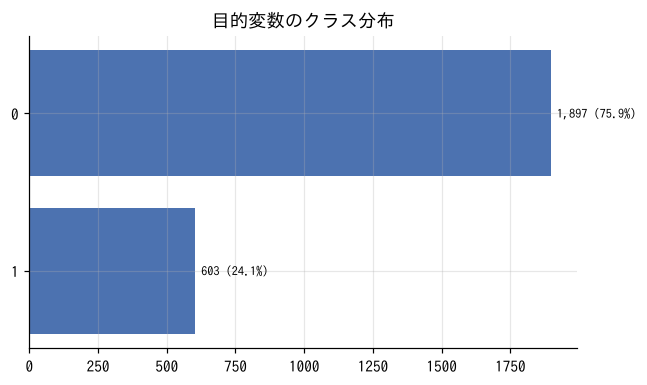
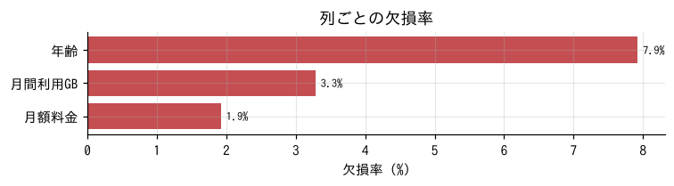
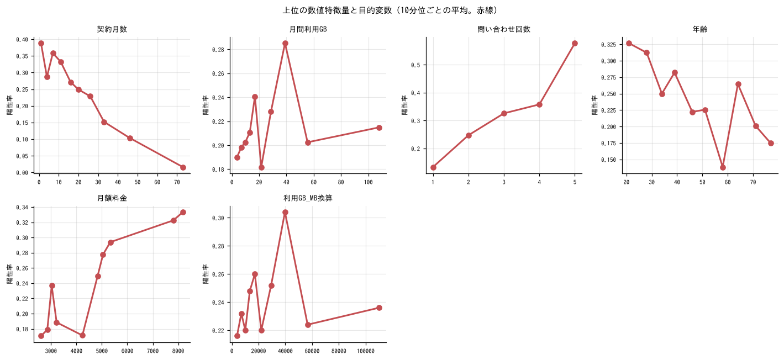
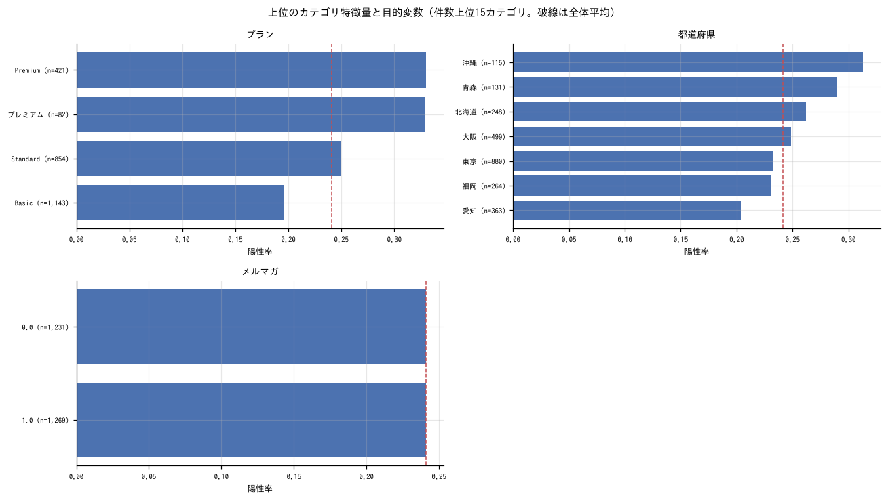
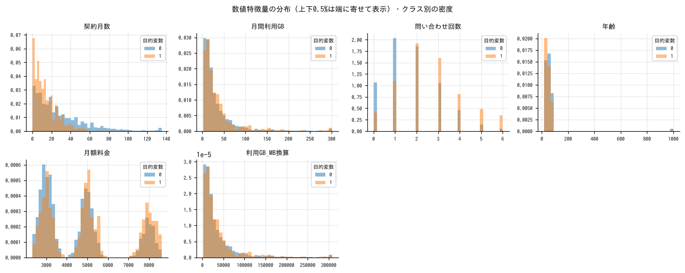
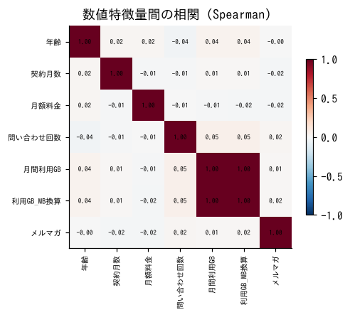
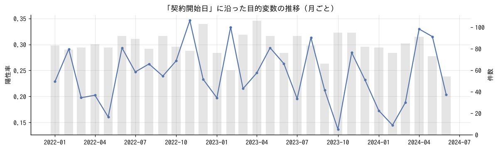
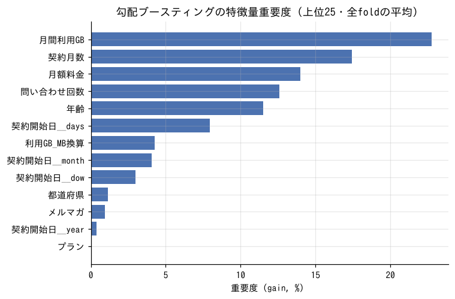
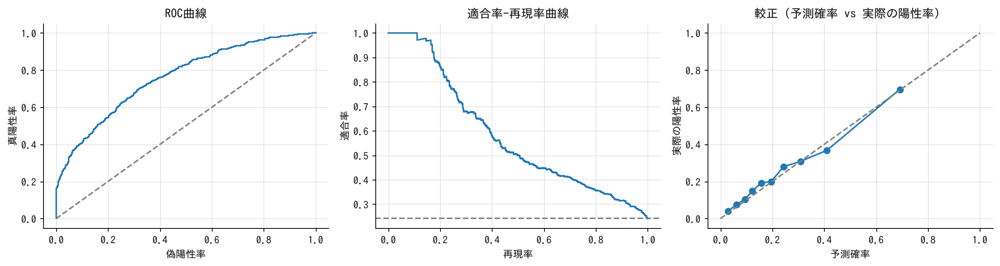

# 初期分析レポート: 解約予測（架空のサンプルデータ）

- 実行日: 2026-11-06　／　データ: `train.csv`（2,500行 × 13列）　／　テスト: `test.csv`
- 課題: 通信サービスの顧客が解約するかを予測し、解約しそうな顧客に先回りで対策したい
- 目的変数: `解約`（2値分類、陽性クラス = `1`）　／　主指標: **auc**
- 分析対象: 2,500行、特徴量 10列（ID 1列は除外）

## 0. まとめと考察

> これは**架空のサンプルデータ**でスキルの動作を示す見本です（実データの分析ではありません）。

### 結論（3行）
- 解約率は 24.1%。**契約月数が短い・問い合わせが多い・料金が高い**ほど解約しやすく、この3つで大半が説明できる。
- ベースラインは AUC 0.78（ロジスティック回帰）。LightGBM は 0.764 で、学習 0.947 との差が大きく過学習気味。データ 2,500 行に対して木が複雑すぎる。
- **`月間利用GB` が欠損の 82 人は全員解約**している。解約後に利用データが取れなくなった結果（リーク）の可能性が高く、使ってよいかの確認が最優先。

### データの品質で気になる点
- **`年齢` に 999 が 28 件**: 欠損コードと思われる（他は 18〜79 歳）。初期モデルでは欠損扱いにした。
- **`月間利用GB` の欠損 82 件（3.3%）がすべて解約者**: 「解約したから利用量が記録されていない」なら、予測時点では使えない情報。予測したい時点で利用量が分かるかを確認したい。
- **`プラン` の表記ゆれ**: `basic ` → `Basic` は自動で統一済み。`プレミアム`（82 件）と `Premium`（421 件）は解約率が 32.9% と 33.0% でほぼ同じで、同じプランと思われる（初期モデルで統合）。
- `利用GB_MB換算` は `月間利用GB` × 1024 で同じ情報（相関 1.00）。削除してよい。
- `国` は全行「日本」なので自動で削除した。

### 見えた傾向
| 列 | 傾向（解約率） |
|---|---|
| 契約月数 | 0〜6 か月 32.9%、7〜12 か月 **36.6%**（最も高い）、13〜24 か月 25.2%、25〜48 か月 16.8%、49 か月〜 **4.1%**。1 年目の終わりに山がある |
| 問い合わせ回数 | 0 回 10.9% → 2 回 24.8% → 4 回 35.8% → 5 回以上 **57.7%**。ほぼ直線的に上がる |
| 月額料金 | 下位半分 18.9% → 上位 1/4 **33.8%**。4,700 円を超えると上がる |
| プラン | Basic 19.6% / Standard 24.9% / Premium 33.0%（料金と同じ向き） |
| 年齢 | 30 歳以下 33.0%、31〜45 歳 24.9%、46 歳以上 約 20% |
| 都道府県 | 沖縄 31.0%、青森 30.6% がやや高い（それぞれ 116 人・134 人と少なく、偶然の範囲かもしれない） |

- 時期（契約開始日）による解約率の変化ははっきりしない（月ごとに 14〜35% で上下）。
- train と test の分布はほぼ同じ（見分けるモデルの AUC 0.49）。

### 特徴量エンジニアリングの提案（優先順）
| # | 案 | 根拠（数字） | 期待効果 | 初期モデルで試した結果 |
|---|---|---|---|---|
| 1 | `月間利用GB` の欠損を使うか決める | 欠損 82 人が全員解約 | 使えるなら強い。リークなら除外が必須 | 欠損フラグを追加（重要度 1.2%）。**リークの確認が先** |
| 2 | 問い合わせ回数 ÷ 契約月数（問い合わせ頻度） | 両方とも解約と強く関係 | 「短期間に何度も問い合わせた」不満の強さ | **重要度 1 位（21.6%）** |
| 3 | 同じプランの平均料金との差（割高感） | 料金が高いほど解約。プラン内でも料金にばらつき | プランと料金の効果を切り分ける | 重要度 8.8% |
| 4 | 年齢 999 を欠損に | 999 が 28 件 | 線形モデルでの歪みを防ぐ | 実施 |
| 5 | 契約月数を「1 年目」「更新月の前後」で区切る | 7〜12 か月で解約率が最も高い | 契約更新のタイミングを表す | 未実施 |
| 6 | 契約月数・利用GB の log 変換 | 歪度 2.1 / 4.8 | 線形モデルの精度向上（木モデルには不要） | 未実施 |
| 7 | 都道府県を「地方」にまとめる | 件数の少ない県で解約率が高め | ばらつきを抑える | 未実施 |

### モデルについて
- AUC: 何もしない 0.5 → ロジスティック回帰 **0.781** → LightGBM 0.764 → LightGBM＋特徴量 0.770（+0.005）。
- 線形モデルが木モデルより良いのは、関係がほぼ単調（多いほど・長いほど）で行数が少ないため。LightGBM は木を浅くする（`num_leaves` 7〜15、`min_child_samples` 50 程度）と差が縮まるはず。
- 解約率 24% なので accuracy は 0.76 が「全員解約しない」と答えたときの値。AUC と PR-AUC で判断する。
- 大きく外した行は「契約月数が長く（38〜73 か月）、問い合わせ 0〜1 回」なのに解約した人。今のデータでは説明できない理由（引っ越し・他社の乗り換えキャンペーンなど）がありそう。

### 次の一手
1. `月間利用GB` の欠損の意味を確認する（リークなら除外して再実行）。
2. 問い合わせ頻度・割高感を入れた状態で、ロジスティック回帰にも同じ特徴量（＋ log 変換）を入れて比べる。
3. LightGBM の木を浅くして過学習を抑える。
4. 「解約しそうな上位何 % に連絡するか」で閾値を決め、その範囲での適合率・再現率を出す。
5. 可能なら、問い合わせの内容（カテゴリ）や直近の利用量の変化を追加データとして入手する。

## 1. データクレンジングの記録

| 処理 | 内容 |
|---|---|
| 読み込み | 文字コード utf-8-sig、区切り文字 `,`、2,500行 × 13列（全列を文字列として読み、型は後で推定） |
| 列名の正規化（全角→半角・空白→_・重複/空の列名） | 1列: ` 顧客ID`→`顧客ID` |
| 全角英数・記号を半角に、前後の空白を除去 | 2,534セル |
| 欠損の表記を統一（空文字・NA・- など → 欠損） | 328セル。空文字以外: '-'(48) |
| `月額料金` の型変換（→numeric） | 桁区切り・通貨記号・% を除去して数値化 |
| `メルマガ` の型変換（→bool） | ['いいえ', 'はい'] を 0/1 に変換 |
| `プラン` の表記ゆれを統一（大文字小文字・空白・記号の違い） | 40セル: 'basic'→'Basic' |
| 値が1種類しかない列を削除 | 国 |
| ID列と判断して特徴量から除外 | 顧客ID（--id で明示指定も可） |
| （要確認）`年齢` の値 | `999` が 28件（他の値から大きく外れている）。置換はしていません |
| （要確認）`月間利用GB` の値 | 極端な値が 8件（例: 400.15, 693.35, 470.06）。置換はしていません |
| （要確認）`利用GB_MB換算` の値 | 極端な値が 8件（例: 409,758, 709,989, 481,339）。置換はしていません |

## 2. 目的変数



| クラス | 件数 | 割合 |
|---|---|---|
| 0 | 1,897 | 75.9% |
| 1 | 603 | 24.1% |

- 多数クラス / 少数クラス = 3.1 倍

## 3. 列ごとのプロファイル

### 数値の列

| 列 | 種類 | 役割 | 欠損率 | ユニーク数 | 平均 | 標準偏差 | 最小 | 中央値 | 最大 | 歪度 | ゼロ率 | 外れ値率(IQR1.5) | 負の値 |
|---|---|---|---|---|---|---|---|---|---|---|---|---|---|
| 年齢 | numeric | 特徴量 | 7.9% | 63 | 59.781 | 105.722 | 18 | 48 | 999 | 8.529 | 0.0% | 1.2% | 0 |
| 契約月数 | numeric | 特徴量 | 0.0% | 133 | 24.331 | 24.526 | 0 | 17 | 227 | 2.111 | 2.0% | 5.1% | 0 |
| 月額料金 | numeric | 特徴量 | 1.9% | 1,707 | 4,703.094 | 1,912.665 | 1,882 | 4,695.5 | 8,870 | 0.712 | 0.0% | 0.1% | 0 |
| 問い合わせ回数 | numeric | 特徴量 | 0.0% | 9 | 1.975 | 1.391 | 0 | 2 | 8 | 0.691 | 13.6% | 0.2% | 0 |
| 月間利用GB | numeric | 特徴量 | 3.3% | 1,963 | 33.737 | 46.885 | 0.45 | 19.095 | 693.35 | 4.824 | 0.0% | 8.3% | 0 |
| 利用GB_MB換算 | numeric | 特徴量 | 0.0% | 2,450 | 34,383.254 | 47,636.871 | 459 | 19,533.5 | 709,989 | 4.816 | 0.0% | 8.3% | 0 |
| メルマガ | bool | 特徴量 | 0.0% | 2 | 0.508 | 0.5 | 0 | 1 | 1 | -0.03 | 49.2% | 0.0% | 0 |
| 解約 | numeric | 目的変数 | 0.0% | 2 | 0.241 | 0.428 | 0 | 0 | 1 | 1.211 | 75.9% | 0.0% | 0 |

### カテゴリ・日時・テキストの列

| 列 | 種類 | 役割 | 欠損率 | ユニーク数 | 最頻値 | 最頻値の割合 | 1%未満のカテゴリ数 | 平均文字数 | 最小 | 最大 |
|---|---|---|---|---|---|---|---|---|---|---|
| 顧客ID | category | ID（学習に使わない） | 0.0% | 2,500 | C00000 | 0.0% | 2,500 | 6 | - | - |
| プラン | category | 特徴量 | 0.0% | 4 | Basic | 45.7% | 0 | 6.362 | - | - |
| 都道府県 | category | 特徴量 | 0.0% | 7 | 東京 | 35.2% | 0 | 2.099 | - | - |
| 契約開始日 | datetime | 特徴量 | 0.0% | 842 | - | - | - | - | 2022-01-01 00:00:00 | 2024-06-18 00:00:00 |

全項目は `column_profile.csv` を参照。

## 4. 欠損



欠損の有無と目的変数の関係（p値が小さい＝欠損そのものに情報がある可能性）:

| 特徴量 | 欠損率 | 欠損時の陽性率 | 非欠損時の陽性率 | p値 | 欠損に意味がありそう |
|---|---|---|---|---|---|
| 月間利用GB | 3.3% | 100.0% | 21.5% | 5.03e-59 | ○ |
| 月額料金 | 1.9% | 18.8% | 24.2% | 0.479 |  |
| 年齢 | 7.9% | 22.7% | 24.2% | 0.696 |  |

## 5. 目的変数との関係（単変量）

相互情報量（非線形の関係も拾う指標）の大きい順。`指標` は列の種類に応じた関係の強さ。

| 特徴量 | 種類 | 相互情報量 | 欠損率 | 指標 | 値 | 向き |
|---|---|---|---|---|---|---|
| 契約月数 | numeric | 0.036 | 0.0% | 単変量AUC | 0.336 | 小さいほど陽性 |
| 月間利用GB | numeric | 0.032 | 3.3% | 単変量AUC | 0.519 | 大きいほど陽性 |
| 問い合わせ回数 | numeric | 0.03 | 0.0% | 単変量AUC | 0.665 | 大きいほど陽性 |
| 年齢 | numeric | 0.011 | 7.9% | 単変量AUC | 0.431 | 小さいほど陽性 |
| 月額料金 | numeric | 0.009 | 1.9% | 単変量AUC | 0.59 | 大きいほど陽性 |
| プラン | category | 0.007 | 0.0% | Cramér's V | 0.118 | - |
| 契約開始日 | datetime | 0.003 | 0.0% | 単変量AUC | 0.496 | 小さいほど陽性 |
| 都道府県 | category | 0.002 | 0.0% | Cramér's V | 0.06 | - |
| メルマガ | bool | 1.20e-08 | 0.0% | 単変量AUC | 0.5 | 小さいほど陽性 |
| 利用GB_MB換算 | numeric | 0 | 0.0% | 単変量AUC | 0.513 | 大きいほど陽性 |







**`プラン` のカテゴリ別**（件数上位10）

| カテゴリ | 件数 | 陽性率 |
|---|---|---|
| Basic | 1,143 | 19.6% |
| Standard | 854 | 24.9% |
| Premium | 421 | 33.0% |
| プレミアム | 82 | 32.9% |

**`都道府県` のカテゴリ別**（件数上位10）

| カテゴリ | 件数 | 陽性率 |
|---|---|---|
| 東京 | 880 | 23.3% |
| 大阪 | 499 | 24.8% |
| 愛知 | 363 | 20.4% |
| 福岡 | 264 | 23.1% |
| 北海道 | 248 | 26.2% |
| 青森 | 131 | 29.0% |
| 沖縄 | 115 | 31.3% |

## 6. 特徴量間の相関



|ρ| ≥ 0.9 の組（ほぼ同じ情報を持つ列）:

| 列A | 列B | Spearman ρ |
|---|---|---|
| 月間利用GB | 利用GB_MB換算 | 1 |

## 7. 時間に沿った推移



## 8. train と test の違い

- train と test を見分けるモデルの AUC = **0.495**（0.5 に近いほど同じ分布。0.7 を超えると要注意）
- 見分けに効いている列: `月額料金`(20%), `月間利用GB`(17%), `年齢`(16%), `契約開始日__days`(13%), `契約月数`(12%)

| 特徴量 | 指標 | 値 | train平均 | test平均 | 欠損率(train) | 欠損率(test) |
|---|---|---|---|---|---|---|
| 問い合わせ回数 | KS統計量 | 0.054 | 1.975 | 2.074 | 0.0% | 0.0% |
| 利用GB_MB換算 | KS統計量 | 0.054 | 34,383.254 | 34,365.354 | 0.0% | 0.0% |
| 月間利用GB | KS統計量 | 0.052 | 33.737 | 33.783 | 3.3% | 3.8% |
| 契約月数 | KS統計量 | 0.033 | 24.331 | 24.33 | 0.0% | 0.0% |
| 年齢 | KS統計量 | 0.026 | 59.781 | 63.826 | 7.9% | 7.0% |
| 月額料金 | KS統計量 | 0.026 | 4,703.094 | 4,698.104 | 1.9% | 1.5% |
| メルマガ | KS統計量 | 0.012 | 0.508 | 0.52 | 0.0% | 0.0% |
| 都道府県 | trainに無いカテゴリの割合 | 0 | - | - | 0.0% | 0.0% |
| プラン | trainに無いカテゴリの割合 | 0 | - | - | 0.0% | 0.0% |
| 契約開始日 | 期間 | - | 2022-01-01〜2024-06-18 | 2022-01-01〜2024-06-17 | 0.0% | 0.0% |

## 9. 特徴量エンジニアリングの候補（自動抽出）

データの統計から機械的に挙げた候補です。ドメイン知識での取捨選択が前提。優先度「高」は目的変数との関係が強い列や効果が大きい処理。

| 優先度 | 対象 | 観察 | 提案 |
|---|---|---|---|
| 高 | 年齢 | `999` が 28件（他の値から大きく外れている） | 欠損コードの可能性。意味を確認し、欠損として扱う（NaN に置換＋欠損フラグ） |
| 高 | 月間利用GB | 極端な値が 8件（例: 400.15, 693.35, 470.06） | 入力ミスか確認。誤りなら修正/除外、正しければクリップ |
| 高 | 利用GB_MB換算 | 極端な値が 8件（例: 409,758, 709,989, 481,339） | 入力ミスか確認。誤りなら修正/除外、正しければクリップ |
| 高 | 契約月数 | 分布が大きく偏っている（歪度 2.1） | log1p 変換（線形モデル・NN向け。木モデルでは不要） |
| 高 | 契約月数 | 外れ値が多い（IQR基準で 5.1%） | 上下1%でクリップ、または順位（rank）変換。入力ミスによる異常値か確認 |
| 高 | 月間利用GB | 分布が大きく偏っている（歪度 4.8） | log1p 変換（線形モデル・NN向け。木モデルでは不要） |
| 高 | 月間利用GB | 外れ値が多い（IQR基準で 8.3%） | 上下1%でクリップ、または順位（rank）変換。入力ミスによる異常値か確認 |
| 高 | 月間利用GB | 欠損の有無で目的変数が変わる（p=5.03e-59） | 欠損フラグ列を追加（欠損そのものが情報） |
| 高 | 問い合わせ回数 | 値の種類が少ない（9種） | カテゴリとしても扱って比較（one-hot / target encoding） |
| 高 | 年齢 | 分布が大きく偏っている（歪度 8.5） | log1p 変換（線形モデル・NN向け。木モデルでは不要） |
| 高 | 契約開始日 | 日時の列 | 年・月・曜日・時刻・祝日フラグ、基準日からの経過日数に分解。周期性は sin/cos。未来の情報を使わないよう時系列で検証 |
| 高 | 契約月数, 月間利用GB, 問い合わせ回数, 年齢 | 目的変数との関係が強い数値特徴量 | 上位どうしの比・差・積（例: 金額÷回数＝単価）。ドメイン的に意味のある組み合わせを優先 |
| 高 | プラン × 契約月数 | 上位のカテゴリと数値 | `プラン` ごとの `契約月数` の平均・標準偏差、その平均との差（グループ集約特徴量） |
| 中 | プラン | カテゴリ数 4種 | one-hot（線形）またはそのままカテゴリ型（LightGBM） |
| 中 | 都道府県 | カテゴリ数 7種 | one-hot（線形）またはそのままカテゴリ型（LightGBM） |
| 中 | 利用GB_MB換算 | 分布が大きく偏っている（歪度 4.8） | log1p 変換（線形モデル・NN向け。木モデルでは不要） |
| 中 | 利用GB_MB換算 | 外れ値が多い（IQR基準で 8.3%） | 上下1%でクリップ、または順位（rank）変換。入力ミスによる異常値か確認 |
| 中 | 月間利用GB / 利用GB_MB換算 | 強い相関（ρ=1.00） | 片方を削る、または比・差を特徴量にする |

## 10. ベースラインモデル

- 検証方法: 層化5分割交差検証
- モデルに入れた特徴量: 13列（日時は年・月・曜日・経過日数に分解、テキストは文字数のみ、カテゴリは LightGBM ではカテゴリ型／線形では one-hot）
- 前処理は最小限（欠損補完は中央値、スケーリングは線形のみ）。ここからの改善幅を測るための基準値です。

| モデル | auc | pr_auc | logloss | accuracy | f1 | 学習データでのauc | 秒 |
|---|---|---|---|---|---|---|---|
| ベースライン（平均/事前確率のみ） | 0.5 ± 0 | 0.241 ± 0.001 | 0.552 ± 0.001 | 0.759 ± 0.001 | 0 ± 0 | 0.5 | 0.1 |
| 線形モデル（ロジスティック回帰） | 0.781 ± 0.033 | 0.591 ± 0.051 | 0.44 ± 0.026 | 0.797 ± 0.011 | 0.41 ± 0.031 | 0.798 | 0.2 |
| 勾配ブースティング（LightGBM） | 0.764 ± 0.026 | 0.584 ± 0.035 | 0.454 ± 0.021 | 0.799 ± 0.009 | 0.396 ± 0.035 | 0.947 | 1.0 |

- 勾配ブースティングの auc: 学習 0.947 / 検証 0.764（差 0.182）。差が大きいほど過学習気味。
- 早期終了で選ばれた木の本数（平均）: 117





予測を大きく外した行（上位10。全行の予測は `oof.csv`）:

| 顧客ID | 解約 | pred_1 | 誤差 | 年齢 | 契約月数 | 月額料金 | 問い合わせ回数 | 月間利用GB |
|---|---|---|---|---|---|---|---|---|
| C01382 | 1 | 0.017 | 4.06 | 79 | 73 | 4,298 | 1 | 112.75 |
| C00709 | 1 | 0.021 | 3.856 | 55 | 44 | 3,201 | 1 | 17.6 |
| C01248 | 1 | 0.021 | 3.843 | 74 | 58 | 7,771 | 1 | 16.62 |
| C02105 | 1 | 0.03 | 3.512 | 56 | 53 | 2,497 | 1 | 51.15 |
| C00500 | 1 | 0.03 | 3.496 | 64 | 38 | 3,449 | 0 | 12.14 |
| C02031 | 1 | 0.031 | 3.471 | 46 | 49 | 5,377 | 1 | 38.48 |
| C01791 | 1 | 0.034 | 3.386 | 35 | 17 | 3,610 | 1 | 29.65 |
| C00187 | 1 | 0.038 | 3.267 | 25 | 56 | 7,611 | 1 | 25.8 |
| C00822 | 1 | 0.041 | 3.203 | 70 | 26 | 5,218 | 1 | 18.3 |
| C02387 | 1 | 0.044 | 3.12 | - | 5 | 2,894 | 0 | 5.2 |

- テストデータの予測: `predictions.csv`（全学習データで再学習した勾配ブースティング）

## 11. 初期モデル（特徴量エンジニアリング込み）

`baseline_model.py` の `add_features()` で特徴量を足し、上と同じ分割の交差検証で LightGBM を比べた結果。

| 指標 | 追加前 | 追加後 | 差 |
|---|---|---|---|
| auc | 0.764 | 0.77 | 0.005 |
| pr_auc | 0.584 | 0.587 | 0.003 |
| logloss | 0.454 | 0.453 | -0.001 |
| accuracy | 0.799 | 0.799 | 0 |
| f1 | 0.396 | 0.391 | -0.005 |

追加した処理:

```python
# 1. 欠損コードの扱い: 年齢 999 は欠損とみなす
df["年齢"] = df["年齢"].where(df["年齢"] != 999)
# 2. 欠損そのものが情報: 利用GB が欠損の顧客は全員解約していた
df["利用GB_欠損"] = df["月間利用GB"].isna().astype(int)
# 3. 重複情報の削除: 利用GB_MB換算 は 月間利用GB × 1024
df = df.drop(columns=["利用GB_MB換算"])
# 4. 表記ゆれ（意味的に同じ）: プレミアム と Premium
df["プラン"] = df["プラン"].replace({"プレミアム": "Premium"})
# 5. 比: 契約期間あたりの問い合わせ回数（不満の強さ）
df["問い合わせ_per_月"] = df["問い合わせ回数"] / (df["契約月数"] + 1)
# 6. グループ集約: 同じプランの平均料金との差（割高感）
df["プラン内_料金差"] = df["月額料金"] - df.groupby("プラン")["月額料金"].transform("mean")
```

特徴量追加後の重要度（上位15）:

| 特徴量 | 重要度 |
|---|---|
| 問い合わせ_per_月 | 21.6% |
| 月間利用GB | 20.5% |
| 年齢 | 10.3% |
| 月額料金 | 9.6% |
| プラン内_料金差 | 8.8% |
| 契約月数 | 8.7% |
| 契約開始日__days | 5.8% |
| 問い合わせ回数 | 5.2% |
| 契約開始日__month | 3.0% |
| 契約開始日__dow | 2.5% |
| 利用GB_欠損 | 1.2% |
| 都道府県 | 1.0% |
| メルマガ | 0.7% |
| プラン | 0.7% |
| 契約開始日__year | 0.4% |

## 12. 注意点

- 日時の列がありますがランダム分割で検証しています。本番で「未来を予測する」なら `--time <列>` で時系列分割にしてください（スコアは下がるのが普通）。
- ID と判断した列は除外しています。誤判定なら `--id` で指定し直してください。

## 出力ファイル

`cleaned_train.csv` / `cleaned_test.csv`（クレンジング後）、`y.csv`（目的変数を数値化したもの）、`column_profile.csv`、`univariate.csv`、`oof.csv`（交差検証の予測）、`worst_errors.csv`、`results.json`、`predictions.csv`
