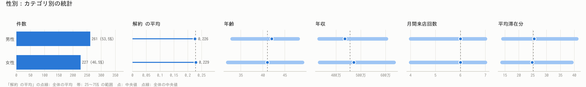
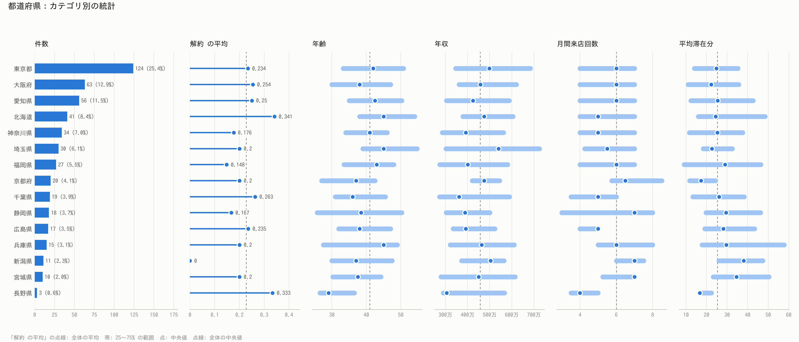
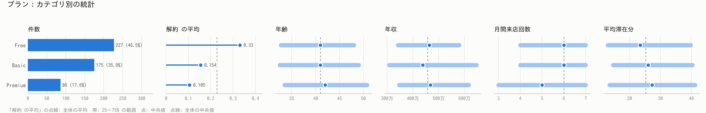
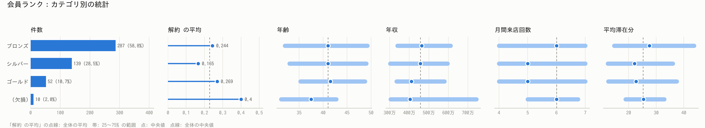
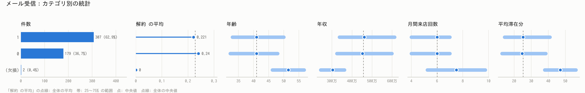
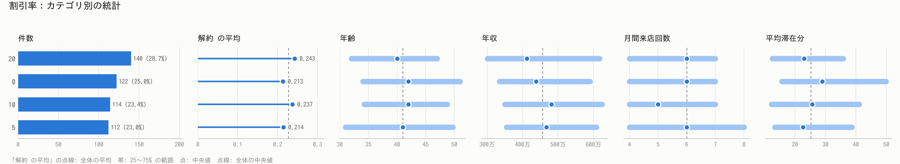
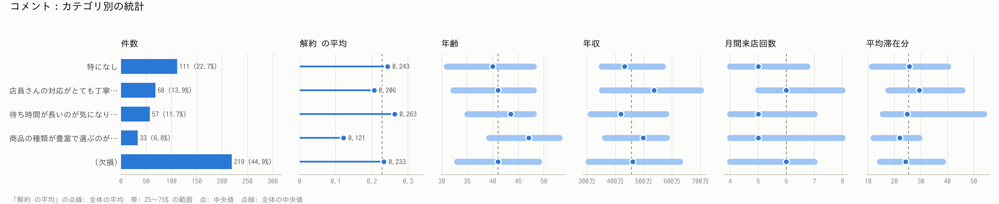

# カテゴリ別の統計の可視化: cleaned.csv

**役割**: カテゴリ列ごとに、各カテゴリの件数と数値列の統計を図にして画像で保存する（データは変更しない）

- 入力: analysis/example_dataprep_sample/02_cleanse/cleaned.csv
- 状態: クレンジング済み（schema あり）
- 画像: analysis/example_dataprep_sample/07_visualize/figs（7 枚、200 dpi）
- 数値の一覧: analysis/example_dataprep_sample/07_visualize/category_stats.csv
- 作成日時: 2026-11-12 10:06

## 1. 図にした列

| カテゴリ列 | 種類数 | 表示したカテゴリ | 画像 |
|---|---|---|---|
| 性別 | 2 | 2 | figs/性別.png |
| 都道府県 | 15 | 15 | figs/都道府県.png |
| プラン | 3 | 3 | figs/プラン.png |
| 会員ランク | 3 | 4 | figs/会員ランク.png |
| メール受信 | 2 | 3 | figs/メール受信.png |
| 割引率 | 4 | 4 | figs/割引率.png |
| コメント | 4 | 5 | figs/コメント.png |

| 図に入れた数値 | 全体の平均 | 全体の中央値 |
|---|---|---|
| 解約 | 0.227 | 0 |
| 年齢 | 41.556 | 41 |
| 年収 | 5.04e+06 | 4,564,000 |
| 月間来店回数 | 5.792 | 6 |
| 平均滞在分 | 29.762 | 25.2 |

図の読み方: 左端が各カテゴリの件数（割合）。数値列は、薄い帯がそのカテゴリの 25〜75% の範囲、点が中央値、点線が全体の中央値。点が点線から離れているカテゴリほど、その数値が全体と違う。件数の少ないカテゴリは値がぶれやすいので件数と合わせて読む。

## 2. 列ごとの図と数値

### 性別

| カテゴリ | 件数 | 割合 | 解約 の平均 | 年齢 の中央値 | 年収 の中央値 | 月間来店回数 の中央値 | 平均滞在分 の中央値 |
|---|---|---|---|---|---|---|---|
| 男性 | 261 | 53.5% | 0.226 | 42 | 4,353,000 | 6 | 25.5 |
| 女性 | 227 | 46.5% | 0.229 | 41 | 4,713,000 | 6 | 24.8 |

`解約` の平均が最も高いのは **女性**（0.229、227 件）、最も低いのは **男性**（0.226、261 件）。20 件以上のカテゴリで比較。

### 都道府県

| カテゴリ | 件数 | 割合 | 解約 の平均 | 年齢 の中央値 | 年収 の中央値 | 月間来店回数 の中央値 | 平均滞在分 の中央値 |
|---|---|---|---|---|---|---|---|
| 東京都 | 124 | 25.4% | 0.234 | 42 | 4,983,000 | 6 | 24.8 |
| 大阪府 | 63 | 12.9% | 0.254 | 38 | 4,584,000 | 6 | 22.25 |
| 愛知県 | 56 | 11.5% | 0.25 | 42.5 | 4,249,000 | 6 | 25.35 |
| 北海道 | 41 | 8.4% | 0.341 | 45 | 4,748,000 | 5 | 24.4 |
| 神奈川県 | 34 | 7.0% | 0.176 | 41 | 3,920,000 | 5 | 25.3 |
| 埼玉県 | 30 | 6.1% | 0.2 | 45 | 5,400,000 | 5.5 | 22.65 |
| 福岡県 | 27 | 5.5% | 0.148 | 43 | 4,013,500 | 6 | 28.95 |
| 京都府 | 20 | 4.1% | 0.2 | 37 | 4,750,000 | 6.5 | 17.25 |
| 千葉県 | 19 | 3.9% | 0.263 | 36 | 3,619,000 | 5 | 26.1 |
| 静岡県 | 18 | 3.7% | 0.167 | 38.5 | 3,883,500 | 7 | 29.45 |
| 広島県 | 17 | 3.5% | 0.235 | 38 | 3,919,500 | 5 | 28.2 |
| 兵庫県 | 15 | 3.1% | 0.2 | 45 | 4,636,000 | 6 | 29.6 |
| 新潟県 | 11 | 2.3% | 0 | 37 | 5,045,000 | 7 | 38.1 |
| 宮城県 | 10 | 2.0% | 0.2 | 37.5 | 4,505,500 | 7 | 34.55 |
| 長野県 | 3 | 0.6% | 0.333 | 29 | 3,051,000 | 4 | 16.7 |

`解約` の平均が最も高いのは **北海道**（0.341、41 件）、最も低いのは **福岡県**（0.148、27 件）。20 件以上のカテゴリで比較。

### プラン

| カテゴリ | 件数 | 割合 | 解約 の平均 | 年齢 の中央値 | 年収 の中央値 | 月間来店回数 の中央値 | 平均滞在分 の中央値 |
|---|---|---|---|---|---|---|---|
| Free | 227 | 46.5% | 0.33 | 41 | 4,640,000 | 6 | 23.4 |
| Basic | 175 | 35.9% | 0.154 | 41 | 4,380,000 | 6 | 26 |
| Premium | 86 | 17.6% | 0.105 | 42 | 4,676,500 | 5 | 27.25 |

`解約` の平均が最も高いのは **Free**（0.33、227 件）、最も低いのは **Premium**（0.105、86 件）。20 件以上のカテゴリで比較。

### 会員ランク

| カテゴリ | 件数 | 割合 | 解約 の平均 | 年齢 の中央値 | 年収 の中央値 | 月間来店回数 の中央値 | 平均滞在分 の中央値 |
|---|---|---|---|---|---|---|---|
| ブロンズ | 287 | 58.8% | 0.244 | 41 | 4,635,000 | 6 | 27.55 |
| シルバー | 139 | 28.5% | 0.165 | 41 | 4,564,000 | 5 | 22.15 |
| ゴールド | 52 | 10.7% | 0.269 | 41.5 | 4,104,000 | 5 | 22.7 |
| (欠損) | 10 | 2.0% | 0.4 | 37.5 | 4,037,000 | 6 | 25.35 |

`解約` の平均が最も高いのは **ゴールド**（0.269、52 件）、最も低いのは **シルバー**（0.165、139 件）。20 件以上のカテゴリで比較。

### メール受信

| カテゴリ | 件数 | 割合 | 解約 の平均 | 年齢 の中央値 | 年収 の中央値 | 月間来店回数 の中央値 | 平均滞在分 の中央値 |
|---|---|---|---|---|---|---|---|
| 1 | 307 | 62.9% | 0.221 | 41 | 4,610,000 | 6 | 25.25 |
| 0 | 179 | 36.7% | 0.24 | 41 | 4,516,500 | 6 | 24.7 |
| (欠損) | 2 | 0.4% | 0 | 51.5 | 3,033,000 | 7.5 | 47.05 |

`解約` の平均が最も高いのは **0**（0.24、179 件）、最も低いのは **1**（0.221、307 件）。20 件以上のカテゴリで比較。

### 割引率

| カテゴリ | 件数 | 割合 | 解約 の平均 | 年齢 の中央値 | 年収 の中央値 | 月間来店回数 の中央値 | 平均滞在分 の中央値 |
|---|---|---|---|---|---|---|---|
| 20 | 140 | 28.7% | 0.243 | 40 | 4,119,000 | 6 | 23 |
| 0 | 122 | 25.0% | 0.213 | 42 | 4,383,000 | 6 | 28.95 |
| 10 | 114 | 23.4% | 0.237 | 42 | 4,818,500 | 5 | 25.65 |
| 5 | 112 | 23.0% | 0.214 | 41 | 4,674,000 | 6 | 22.65 |

`解約` の平均が最も高いのは **20**（0.243、140 件）、最も低いのは **0**（0.213、122 件）。20 件以上のカテゴリで比較。

### コメント

| カテゴリ | 件数 | 割合 | 解約 の平均 | 年齢 の中央値 | 年収 の中央値 | 月間来店回数 の中央値 | 平均滞在分 の中央値 |
|---|---|---|---|---|---|---|---|
| 特になし | 111 | 22.7% | 0.243 | 40 | 4,327,000 | 5 | 25.6 |
| 店員さんの対応がとても丁寧で、また利用したいと思いました。 | 68 | 13.9% | 0.206 | 41 | 5,360,000 | 6 | 29.4 |
| 待ち時間が長いのが気になります。改善を期待しています。 | 57 | 11.7% | 0.263 | 43.5 | 4,191,500 | 5 | 24.8 |
| 商品の種類が豊富で選ぶのが楽しいです。 | 33 | 6.8% | 0.121 | 47 | 4,975,500 | 5 | 22 |
| (欠損) | 219 | 44.9% | 0.233 | 41 | 4,610,000 | 6 | 24.2 |

`解約` の平均が最も高いのは **待ち時間が長いのが気になります。改善を期待しています。**（0.263、57 件）、最も低いのは **商品の種類が豊富で選ぶのが楽しいです。**（0.121、33 件）。20 件以上のカテゴリで比較。
